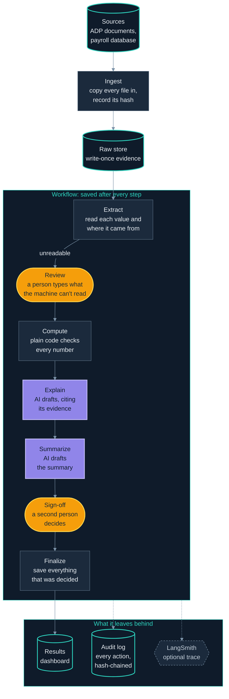

# tax-doc-analysis-agent

[](https://github.com/njagicollins/tax-doc-analysis-agent/actions/workflows/ci.yml)

AI-assisted quarterly payroll tax analysis with full audit traceability. It pulls documents from payroll systems, reads every number with a link back to its page or cell, reconciles them with plain code, has an AI **draft** explanations that must cite their evidence, and lets **people** make every decision, with a second person signing off.

Built on synthetic data only. Runs locally; designed to move to Azure.

## How it works




Orange: the run waits for a person. Violet: the AI drafts text. Dark: plain code. Teal outline: data that is kept. The app's **How it works** tab draws the same steps from the code itself, and shows the trace of any real run.

## Design rules

- **The AI never does the math and never decides.** Checks are deterministic code using `Decimal`. The AI only drafts explanations; every claim must cite evidence it was given, and any number not in that evidence is flagged.
- **Every number is traceable.** Each value carries a `SourceRef` (file hash plus page and box, or sheet and cell). Source files are stored write-once, named by their hash, and re-checked before use.
- **People stay in control, structurally.** A run pauses for a reviewer when a value can't be read, and for a sign-off at the end. Maker-checker is enforced in code: whoever corrected values can't sign off.
- **Personal data never reaches the AI.** Names are replaced by employee IDs and SSNs removed before any call, and a guard blocks the call if anything slips through.
- **Everything is on the record.** A hash-chained, append-only audit log, the code, prompts and models behind each run, and evals that measure the system against an answer key.
- **Safe by default.** Tracing to LangSmith, paid AI evals and anything else that sends data out stay off until switched on.

## Quickstart

Needs [uv](https://docs.astral.sh/uv/), and an OpenAI API key for running the workflow and the AI evals.

```bash
git clone https://github.com/njagicollins/tax-doc-analysis-agent
cd tax-doc-analysis-agent
uv sync
cp .env.example .env
```

In `.env`, put your key in `OPENAI_API_KEY`, and give `MOCK_ADP_API_KEY` and `ADP_API_KEY` the **same** made-up value (the fake ADP checks one against the other).

```bash
uv run python -m synthetic                          # synthetic documents + answer key
uv run uvicorn mock_sources.adp_api:app             # the fake ADP: keep this terminal open
```

In a second terminal:

```bash
uv run taxagent ingest --quarter 2026Q1
uv run taxagent ingest --quarter 2026Q2
uv run taxagent extract --quarter 2026Q1            # last quarter, to compare against
uv run streamlit run src/taxagent/app.py
```

## A five-minute demo

1. **Start a run.** In the sidebar pick *alice*, quarter `2026Q2`, **Start a run**. It reads 369 values from 23 documents and pauses: one W-2 is a blurry scan the machine can't read.
2. **Review.** On the **Runs** tab, alice sees the scan beside six empty boxes and types what it shows.
3. **The AI drafts.** The checks find two things: Form 941 line 2 doesn't match the register (two digits swapped), and E007's wages rose 40% (a bonus). The AI explains each, citing evidence.
4. **Maker-checker.** Try to sign off as alice: refused, because she corrected values. Switch to *bob*: he sees alice's typed values beside the scan, the explanations and the evidence, decides on each finding with no default, and approves.
5. **Look around.** **Dashboard**: checks passed and failed, and what needed a person. **How it works**: the run step by step, with time and decisions. **Audit**: every action in a tamper-evident log.
6. **Measure it.** `uv run python -m evals` checks the pipeline against the answer key.

## Evals

| Eval                           | Question                                                             | Result                                                                                      |
| ------------------------------ | -------------------------------------------------------------------- | ------------------------------------------------------------------------------------------- |
| Detection                      | Does the pipeline find every planted error, and nothing else?        | 4/4 found, recall 100%, precision 100%                                                      |
| Extraction                     | Is every value read exactly as its document shows it?                | 98.4% (720/732); the other 12 honestly unreadable and sent to a person; 0 confidently wrong |
| Explanations (`--llm`, paid) | Are the AI's explanations grounded, right, consistent and leak-free? | grounded 100%, 0 names leaked; consistency varies between runs                              |

Each eval run is saved with the code, prompts and models that produced it, and compared with the previous one. The detection score is high partly because the same person wrote the checks and planted the errors; a real answer key would come from past quarters labelled by people who didn't build the system.

## Commands

| Command                                                | What it does                                             |
| ------------------------------------------------------ | -------------------------------------------------------- |
| `uv run taxagent ingest --quarter Q`                 | pull a quarter's documents into the write-once raw store |
| `uv run taxagent extract --quarter Q`                | read every value, with its source                        |
| `uv run taxagent run --quarter Q`                    | start the workflow (pauses for people)                   |
| `uv run taxagent status --run ID`                    | what a run is waiting for                                |
| `uv run taxagent resume --run ID --answer file.json` | answer a paused run without the app                      |
| `uv run taxagent audit`                              | check the audit log hasn't been changed                  |
| `uv run python -m evals [--llm]`                     | run the evals                                            |
| `uv run pytest -q`                                   | the tests (no network, no API key)                       |

## Project layout

```
src/taxagent/
  ingestion/   sources, write-once raw store, manifest
  extraction/  PDF, Excel and CSV readers, confidence scores
  compute/     reconciliations and variance checks (no AI)
  agent/       LangGraph workflow, LLM doorway, PII masking, trace
  review/      evidence view, corrections, dashboard numbers
  audit/       hash-chained log, provenance, log view
  app.py       Streamlit app
evals/         detection, extraction and explanation evals
synthetic/     the synthetic documents and their answer key
mock_sources/  fake ADP API and payroll database
docs/          architecture, plan, learning log
```

## From local to production

| Here                  | In production (Azure)                  |
| --------------------- | -------------------------------------- |
| mock ADP + SQLite     | ADP API and SQL via Data Factory       |
| `data/raw/` on disk | Blob storage with an immutability lock |
| PyMuPDF               | Document Intelligence                  |
| OpenAI API            | Azure OpenAI (a`.env` change)        |
| SQLite checkpointer   | a server database such as Postgres     |
| simulated login       | Entra ID                               |
| `.env`              | Key Vault                              |

## Known limits

- The audit chain is tamper-**evident**, not tamper-proof: someone with full access can rewrite it and recompute every hash. Keeping the newest hash somewhere they can't reach closes that.
- The answer key was written by the people who built the checks.
- The AI's explanations can differ between runs; that's why they are drafts, checked and signed by people.
- Two people answering the same run are protected within one app process; several servers would need the check in the database.

## More

- [docs/architecture.md](docs/architecture.md): the problem, the questions asked first, and the design.
- [docs/learning-log.md](docs/learning-log.md): how it was built, step by step, with every mistake.
