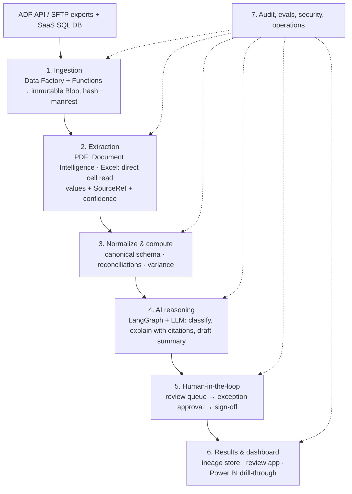

# Architecture

## Problem

Every quarter, corporate tax teams analyze tax documents by hand. The documents are PDFs and Excel files stored in payroll platforms such as ADP and in SaaS SQL databases. The goal is to make that analysis faster, accurate and traceable for audit, with humans keeping control, no manual file handling, and native Azure integration.

This is a **quarterly batch workload**, not a real-time chatbot. We optimize for accuracy, traceability and reviewer efficiency, not latency.

## Questions asked before designing

1. **What exactly is the analysis?** Extracting figures from W-2s, 941s, state filings and payroll registers; reconciling them; comparing quarter over quarter; flagging and explaining variances.
2. **Where is the data, and how do we get it?** Which ADP product is used and whether it offers API access, scheduled report exports or SFTP; the SQL tables; the file counts and sizes.
3. **What does "traceable" mean?** The audit standard (SOX, IRS, internal), how long records must be kept, and who is allowed to approve.
4. **Where does the human stay in control?** Which decisions a person must make and which the system can make on its own.

## Principles

- Traceability before automation
- Determinism where it matters (the LLM never does tax math)
- Human checkpoints are structural (with maker-checker)
- Zero-touch ingestion
- Sensitive data is masked before it reaches the LLM
- Every run is reproducible

## Flow

## Layers

| # | Layer | What it does | Key design decision |
|---|---|---|---|
| 1 | Ingestion | Scheduled, incremental pulls from ADP and SQL into Blob storage | Immutable storage, SHA-256 hash and a manifest prove that the file analyzed is the file received. ADP APIs use OAuth plus a client certificate (mutual TLS), so an Azure Function sits in front of the API and Data Factory orchestrates. The fallback is scheduled report exports over SFTP. Credentials live in Key Vault. |
| 2 | Extraction | Turns PDFs and Excel into structured data | Excel is read cell by cell (never OCR'd). Document Intelligence has prebuilt W-2, 1098 and 1099 models; the 941 and state forms need a custom model or layout plus rules. Page and bounding box are kept for every value. Low-confidence values go to review. |
| 3 | Normalize and compute | Canonical schema; reconciliations and variances | Tested functions return each value together with its source references. |
| 4 | AI reasoning | Classifies documents, explains variances, looks up guidance (retrieval with citations), drafts the summary | Model routing (small model for classification, large model for explanations). Uncited claims are flagged. SSNs and names are masked before any prompt. Private Link to Azure OpenAI. |
| 5 | Human-in-the-loop | Review uncertain fields and exceptions; final sign-off | LangGraph `interrupt` with a persisted checkpointer. Role-based approval and maker-checker. Confidence thresholds are tuned per field against real data. |
| 6 | Results and dashboard | Approved results with lineage | A review app for actions and Power BI for read-only analytics. Drill-through to pre-rendered source-page crops with the value highlighted. |
| 7 | Audit, evaluation and operations | Logging, evaluation, security, deployment | Each run records input hashes and the extraction model, prompt, LLM deployment and code versions, so any quarter can be reproduced. Past quarters form the golden set. Entra ID, Key Vault, Private Link, Terraform, Azure DevOps. |

## Prototype mapping

| Production | Prototype |
|---|---|
| ADP API / SFTP | Mock ADP (FastAPI) serving synthetic files |
| SaaS SQL database | SQLite with synthetic payroll tables |
| Data Factory | Python ingestion job (CLI / APScheduler) |
| Blob Storage | `data/raw/`, write-once, with a SHA-256 manifest |
| Document Intelligence | PyMuPDF (optional Document Intelligence adapter) |
| Azure OpenAI | OpenAI API through the same SDK, switchable by config |
| Review app + Power BI | Streamlit |
| LangSmith / Azure Monitor | Audit table + structured JSON logs |

## Rollout plan (production)

1. **Backtest** on the last 2–4 quarters against what the analysts actually produced.
2. **Shadow run** for one live quarter in parallel with the manual process.
3. **Go live** with conservative review thresholds, and loosen them as accuracy is proven.

Metrics: field-level extraction accuracy, reconciliation match rate, percentage of fields auto-accepted, exception recall, and analyst hours per quarter.
